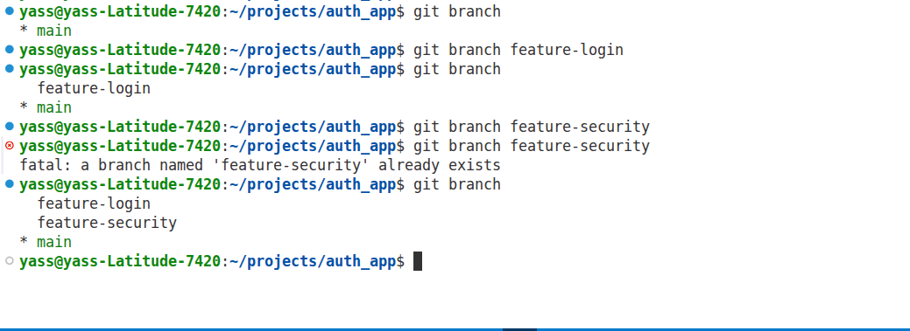
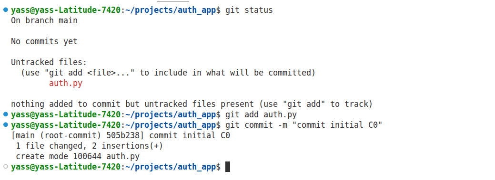
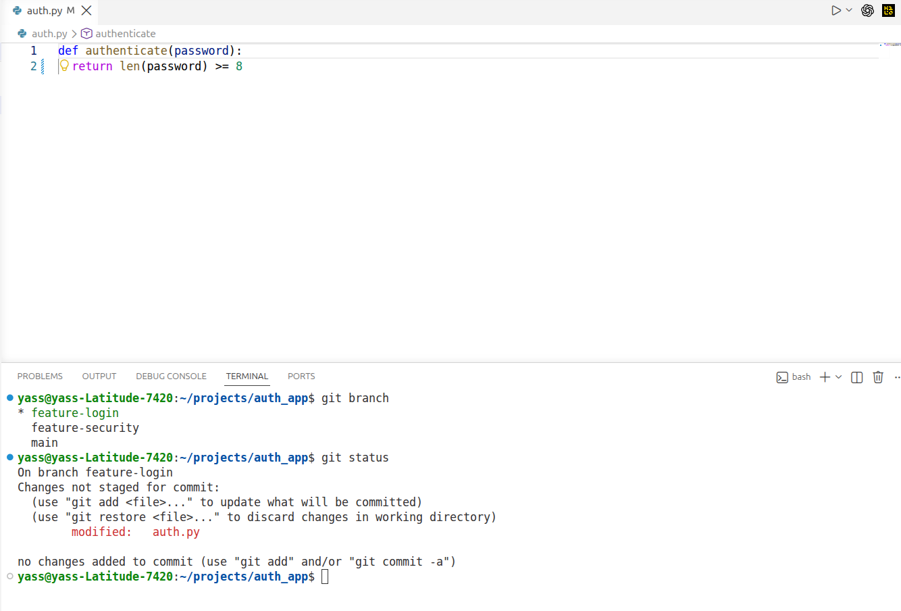
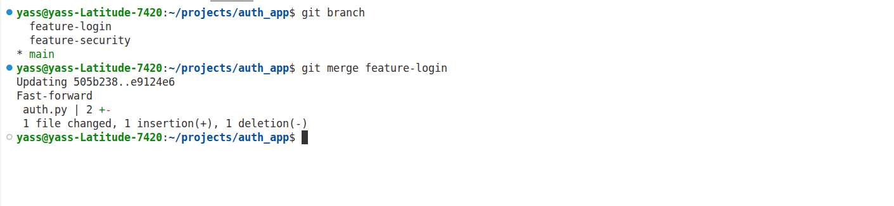
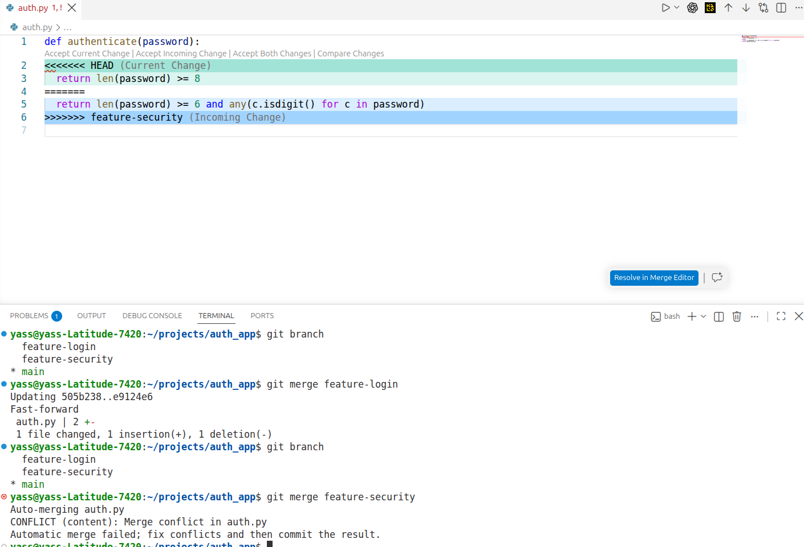

# Exercice 2 : conflit entre les branches feature-login et feature-security

## 1. Contexte

Une équipe travaille sur une application d’authentification. Deux développeurs partent du même commit initial C0 et créent deux branches distinctes :

- le développeur A travaille sur `feature-login`
- le développeur B travaille sur `feature-security`

Le fichier `auth.py` contient une fonction `authenticate(password)` qui est modifiée indépendamment dans les deux branches.

### Version initiale sur `main`

```python
def authenticate(password):
    return len(password) >= 6
```

### Version du développeur A — `feature-login`

```python
def authenticate(password):
    return len(password) >= 8
```

### Version du développeur B — `feature-security`

```python
def authenticate(password):
    return len(password) >= 6 and any(c.isdigit() for c in password)
```

Le développeur A fusionne sa branche dans `main`. Ensuite, le développeur B veut fusionner sa branche dans `main`.

---

## 2. Représentation du graphe des commits avant la fusion de la branche B

Voici un graphe simplifié de l’historique :

```text
C0
├── A1  (feature-login)
│   └── merge dans main ───> M1
│
└── B1  (feature-security)

Quand B tente de fusionner B1 dans M1, Git compare les changements faits
par A et par B sur la même fonction `authenticate()`.
```

Le point important est que A et B sont partis du même commit de base C0, puis ont chacun modifié la même zone du fichier `auth.py`.

### Captures de la création des branches et de l’état initial









---

## 3. Pourquoi la fusion de `feature-security` peut provoquer un conflit

La fusion de `feature-security` peut produire un conflit parce que :

- A et B partent du même commit initial C0 ;
- ils modifient la même fonction `authenticate()` ;
- A a changé la règle sur la longueur du mot de passe ;
- B a ajouté une contrainte supplémentaire sur la présence d’un chiffre ;
- Git tente d’intégrer deux versions différentes de la même ligne de code.

Comme ces deux modifications concernent le même bloc du fichier, Git ne sait pas automatiquement quelle version choisir. Il marque alors un conflit de fusion.

La capture ci-dessous montre précisément le conflit obtenu lorsque le développeur B modifie la même ligne que le développeur A :



Dans ce cas, Git affiche un conflit de type :

```text
CONFLICT (content): Merge conflict in auth.py
```

Cela signifie que les deux branches ont apporté des changements incompatibles sur la même portion de code.

---

## 4. Version corrigée de `authenticate()`

Pour conserver les exigences des deux développeurs, il faut combiner les deux règles :

- la longueur minimale doit être de 8 caractères ;
- le mot de passe doit contenir au moins un chiffre.

Version corrigée :

```python
def authenticate(password):
    return len(password) >= 8 and any(c.isdigit() for c in password)
```

Cette version respecte à la fois :

- la règle de sécurité demandée par le développeur B ;
- la règle de longueur demandée par le développeur A.

---

## 5. Commandes pour fusionner `feature-security` dans `main`, résoudre le conflit et finaliser la fusion

On suppose que le dépôt local est à jour et que l’on se trouve sur `main`.

```bash
git checkout main
git pull --ff-only

git merge feature-security
```

Si un conflit apparaît, Git affiche quelque chose comme :

```text
Auto-merging auth.py
CONFLICT (content): Merge conflict in auth.py
```

Ensuite, il faut ouvrir `auth.py` et régler le conflit manuellement.

Exemple de version finale à conserver :

```python
def authenticate(password):
    return len(password) >= 8 and any(c.isdigit() for c in password)
```

Puis on termine la fusion :

```bash
git add auth.py
git commit -m "Merge feature-security after resolving conflict"
```

Ou, si le dépôt utilise la commande officielle de fusion :

```bash
git merge --continue
```

La commande `git merge --continue` permet de finaliser le merge après résolution du conflit.

---

## 6. Pourquoi travailler sur des branches différentes ne garantit pas l’absence de conflits

Travailler sur des branches différentes réduit les risques, mais ne les élimine pas, car un conflit apparaît dès que :

- deux développeurs partent du même commit de base ;
- ils modifient le même fichier ;
- ils touchent la même zone de code ou la même ligne.

Dans notre exemple, A et B ont tous les deux modifié la fonction `authenticate()`.
Même si leurs branches sont séparées, elles ne sont pas indépendantes au niveau du code source.

Donc, des branches différentes ne garantissent pas l’absence de conflit : elles évitent simplement les conflits liés à un travail simultané non coordonné, mais pas ceux liés à des modifications sur les mêmes lignes.

---

## 7. Conclusion

Ce deuxième exercice montre qu’un conflit de fusion ne vient pas forcément d’une mauvaise manipulation Git, mais du fait que deux évolutions concurrentes modifient le même élément du code.

Le bon réflexe est de :

1. vérifier l’origine commune du code ;
2. comparer les changements des deux branches ;
3. choisir une version finale cohérente ;
4. résoudre le conflit puis terminer la fusion proprement.

---

## 8. Résumé visuel des captures


